# MovieLens 1M 사용자·영화 평점 데이터 시각화 분석

## 1. 프로젝트 개요

- **목표**: 사용자-영화 평점 데이터(MovieLens 1M)를 시각적으로 탐색하여, 유저 정보(성별·나이·직업)만으로 선호 장르를 파악할 수 있는지 확인한다. 신규 유저(Cold-start)에게 추천할 때 활용할 인사이트를 얻기 위한 사전 분석이다.
- **분석 질문**
  1. 어떤 장르의 영화가 많이 만들어지고, 시대에 따라 어떻게 변했는가?
  2. 많이 만들어지는 장르가 평점도 높은가?
  3. 성별·나이대·직업에 따라 선호하는 장르(시청 비율, 평균 평점)가 다른가?

## 2. 데이터셋

[MovieLens 1M Dataset](https://grouplens.org/datasets/movielens/1m/) (GroupLens Research)

| 파일 | 내용 | 규모 |
|---|---|---|
| `movies.dat` | MovieID :: Title(개봉연도 포함) :: Genres(`\|`로 구분된 18개 장르) | 3,883편 |
| `ratings.dat` | UserID :: MovieID :: Rating(1~5) :: Timestamp | 1,000,209건 |
| `users.dat` | UserID :: Gender :: Age(구간 코드) :: Occupation(직업 코드) :: Zip-code | 6,040명 |

데이터셋 이용 약관상 **재배포가 금지**되어 있어 저장소에는 포함하지 않았다. 아래 스크립트로 내려받으면 `data/` 폴더에 세 파일이 생성된다.

```bash
python download_data.py
```

또는 [ml-1m.zip](https://files.grouplens.org/datasets/movielens/ml-1m.zip)을 받아 압축을 풀고 세 개의 `.dat` 파일을 `data/` 폴더에 복사한다.

## 3. 실행 환경 및 실행 방법

```bash
pip install -r requirements.txt
python download_data.py
jupyter notebook movielens_visualization.ipynb
```

- Python 3.10 이상, pandas / numpy / matplotlib / seaborn (버전은 `requirements.txt` 참고)
- 노트북을 위에서부터 순서대로 실행(`Kernel → Restart & Run All`)하면 `figures/` 폴더에 아래 그래프 11장이 저장된다.

## 4. 저장소 구조

```
.
├── movielens_visualization.ipynb   # 전처리 + 시각화 노트북 (본체)
├── download_data.py                # MovieLens 1M 다운로드 스크립트
├── requirements.txt
├── data/                           # (직접 다운로드) movies.dat, ratings.dat, users.dat
└── figures/                        # 노트북 실행 시 저장되는 그래프 이미지
```

## 5. 전처리 요약

1. `::` 구분자 파일 3개를 pandas로 읽어 하나의 테이블로 병합 (`ratings` ⟵ `users` ⟵ `movies`)
2. 제목에서 정규식으로 개봉연도 추출 (`Toy Story (1995)` → 1995)
3. `Genres` 컬럼을 `|` 기준으로 분리한 뒤 `explode`하여 **영화-장르 1:N** 테이블 생성
4. 나이 코드·직업 코드를 읽을 수 있는 라벨로 매핑 (`25` → `25-34`, `12` → `programmer`)
5. 18개 장르에 고정 색상을 배정해 모든 그래프에서 같은 장르가 같은 색으로 보이도록 통일

## 6. 시각화 결과

### 6.0 데이터 개요

**Fig 0. 평점 분포 / 유저별 평가 수 분포** — `seaborn.countplot`, `seaborn.histplot` (로그 y축, 중앙값 표시)
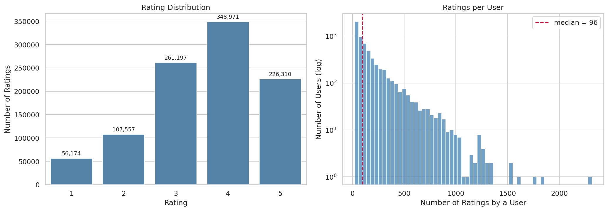
- 평점은 4점(34.9만 건)이 가장 많고 1점은 5.6만 건에 그친다. 유저별 평가 수는 중앙값 96건이지만 최대 2,000건이 넘는 긴 꼬리 분포로, 소수의 유저가 평가의 상당 부분을 차지한다.

### 6.1 영화 산업 트렌드 (영화 단위)

**Fig 1. 장르별 영화 수** — `seaborn.barplot` (가로 막대, 내림차순, 막대 끝 수치 주석)
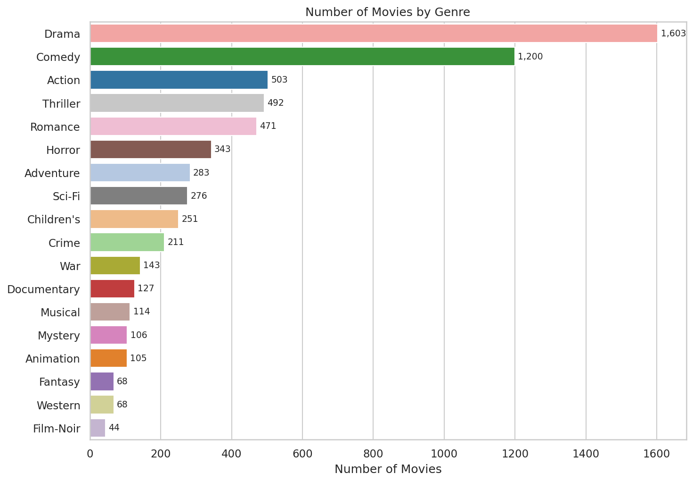
- Drama(1,603편)·Comedy(1,200편)가 압도적으로 많고, Film-Noir(44편)·Western·Fantasy(각 68편)는 희소하다.

**Fig 2. 연도별 개봉 영화 수** — `seaborn.lineplot`
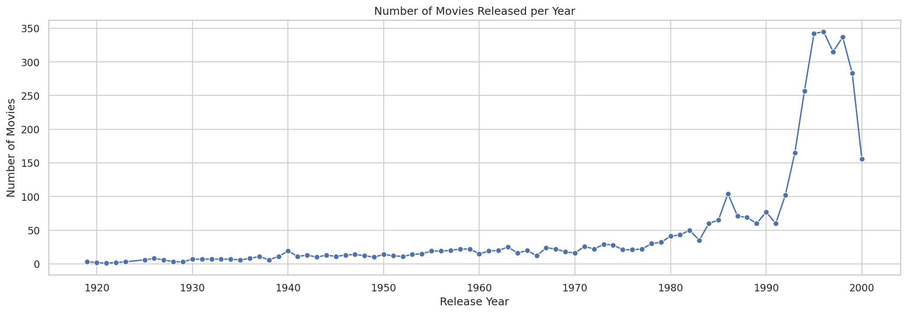
- 1980년대 이후 개봉 수가 급증하며, 2000년 값은 데이터 수집 시점 때문에 낮게 나타난다.

**Fig 3. 상위 5개 장르의 연도별 개봉 추이 (1960년 이후)** — `seaborn.lineplot` + `hue`
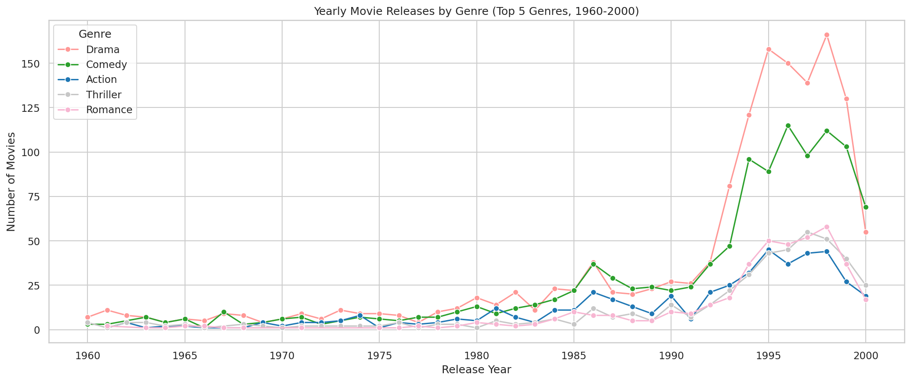
- 1990년대 중반 이후 Drama(연 150편 이상)·Comedy(연 100편 이상)의 증가폭이 가장 크고, Action·Thriller·Romance는 연 50편 안팎으로 비슷한 수준이다.

### 6.2 장르와 평점

**Fig 4. 장르별 평균 평점** — `seaborn.barplot` + `ax.bar_label` + 전체 평균선
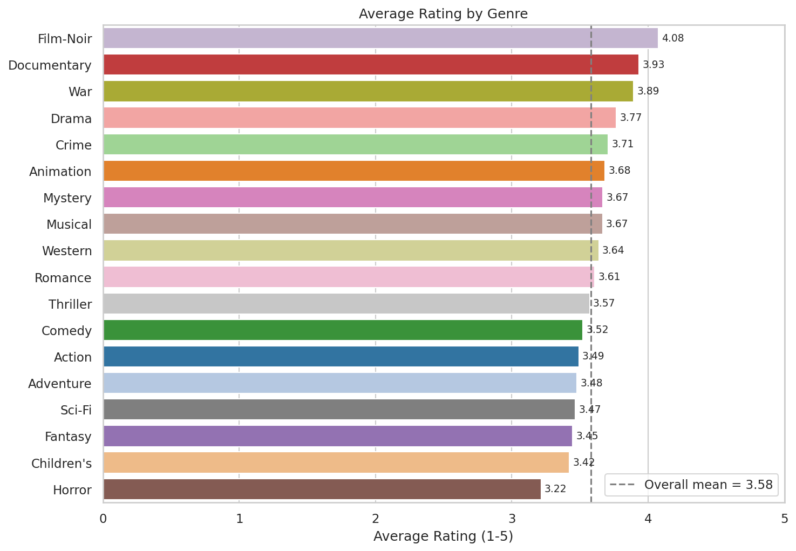
- 전체 평균은 3.58점. 영화 수가 적은 Film-Noir(4.08)·Documentary(3.93)·War(3.89)가 상위이고, 영화 수가 많은 Comedy(3.52)·Action(3.49)은 평균 아래다. Horror(3.22)는 유일하게 평균보다 0.3점 이상 낮다.

**Fig 5. 장르별 영화 수 vs 평균 평점** — `seaborn.scatterplot` + 점 라벨, Spearman 상관계수
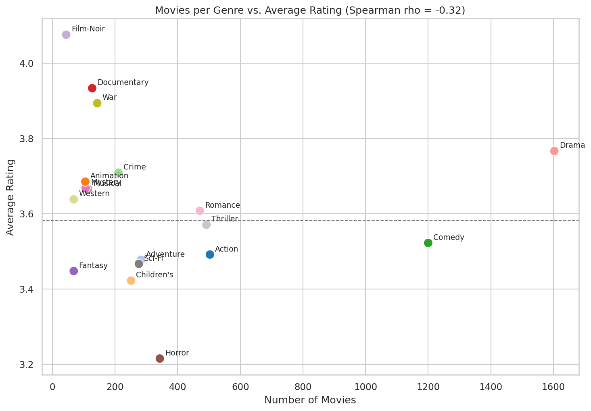
- Spearman 상관계수 -0.32로 오히려 약한 음(-)의 관계다. **많이 만들어지는 장르 ≠ 평점 높은 장르**임을 보여준다.

**Fig 6. 성별 × 장르 평균 평점 히트맵** — `seaborn.heatmap` 2패널 (평균 평점 / 여성-남성 차이, 발산형 컬러맵)
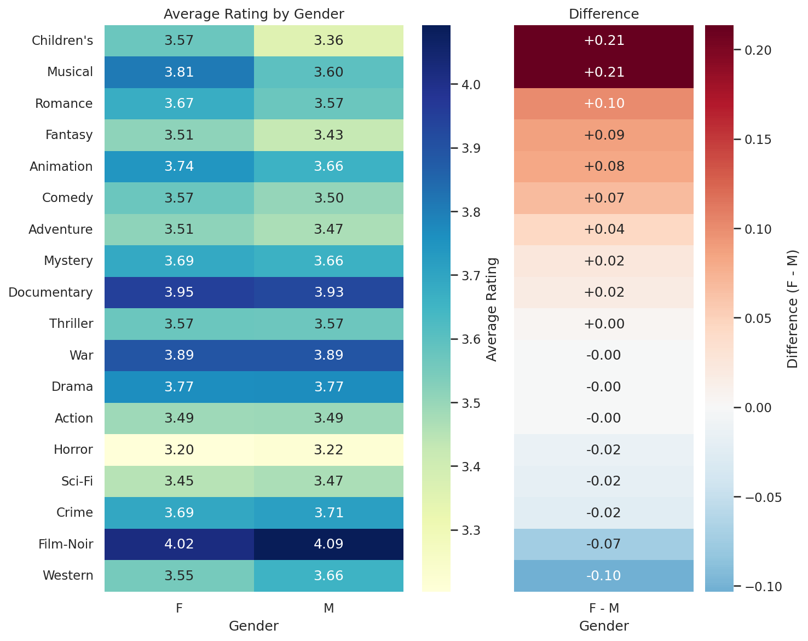
- Children's·Musical(+0.21)·Romance(+0.10)는 여성이, Western(-0.10)·Film-Noir(-0.07)은 남성이 상대적으로 높게 평가한다. Drama·War·Action·Thriller는 성별 차이가 거의 없다.

### 6.3 유저 집단별 선호 장르

남성 유저(4,331명)가 여성(1,709명)보다 2.5배 많으므로 절대 건수가 아니라 **집단 내 시청 비율**로 비교했다.

**Fig 7. 성별 장르 시청 비율 (상위 10개 장르)** — `seaborn.barplot` + `hue=Gender`, 퍼센트 축
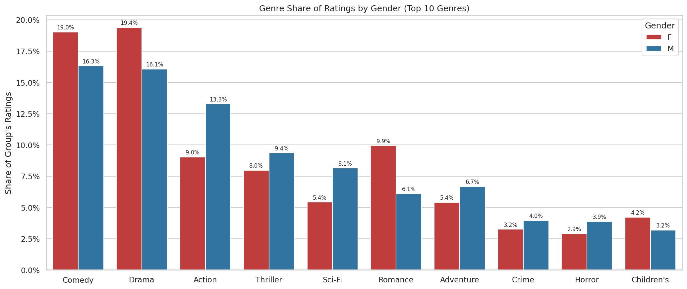
- 여성은 Drama(19.4% vs 16.1%)·Comedy·Romance(9.9% vs 6.1%), 남성은 Action(13.3% vs 9.0%)·Sci-Fi·Thriller 비중이 높다.

**Fig 8. 나이대 × 장르 시청 비율 히트맵** — `seaborn.heatmap`
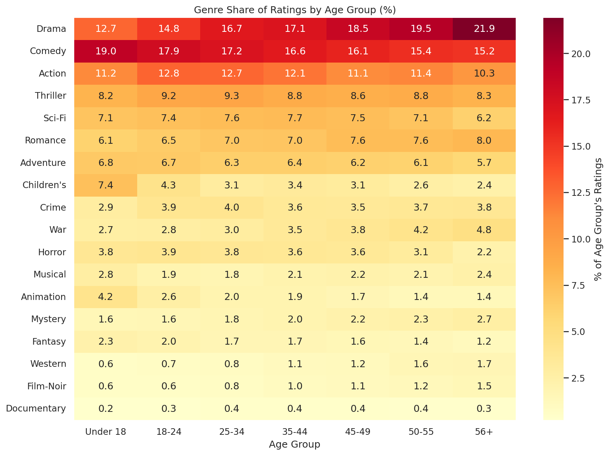
- 18세 미만은 Children's(7.4%)·Animation(4.2%) 비중이 다른 나이대의 2~3배다. 나이가 많아질수록 Drama(12.7% → 21.9%)·War·Romance·Film-Noir 비중이 꾸준히 커지고, Comedy(19.0% → 15.2%)·Action·Horror는 줄어든다.

**Fig 9. 성별·나이대별 상위 5개 장르 비율 파이차트** — `matplotlib.pyplot.pie` 3×3 `subplots` (장르별 고정 색상, 비율 정렬, Others 묶음, 상위 3개 explode)
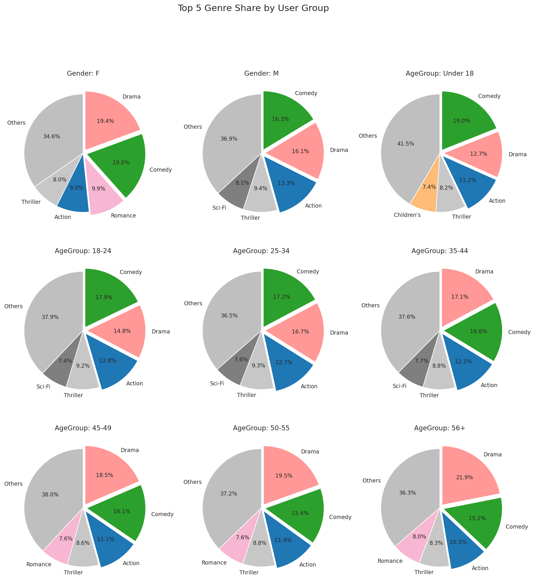
- 모든 집단에서 Drama·Comedy가 1~2위, Action·Thriller가 3~4위로 공통이지만, 5번째 장르가 여성·45세 이상은 Romance, 남성·18~44세는 Sci-Fi, 18세 미만은 Children's로 갈린다. 집단 정보만으로도 초기 추천 장르를 구분할 수 있다.

**Fig 10. 직업별 선호 장르 (전체 평균 대비 차이, %p)** — `seaborn.heatmap` (발산형, 0 중심)
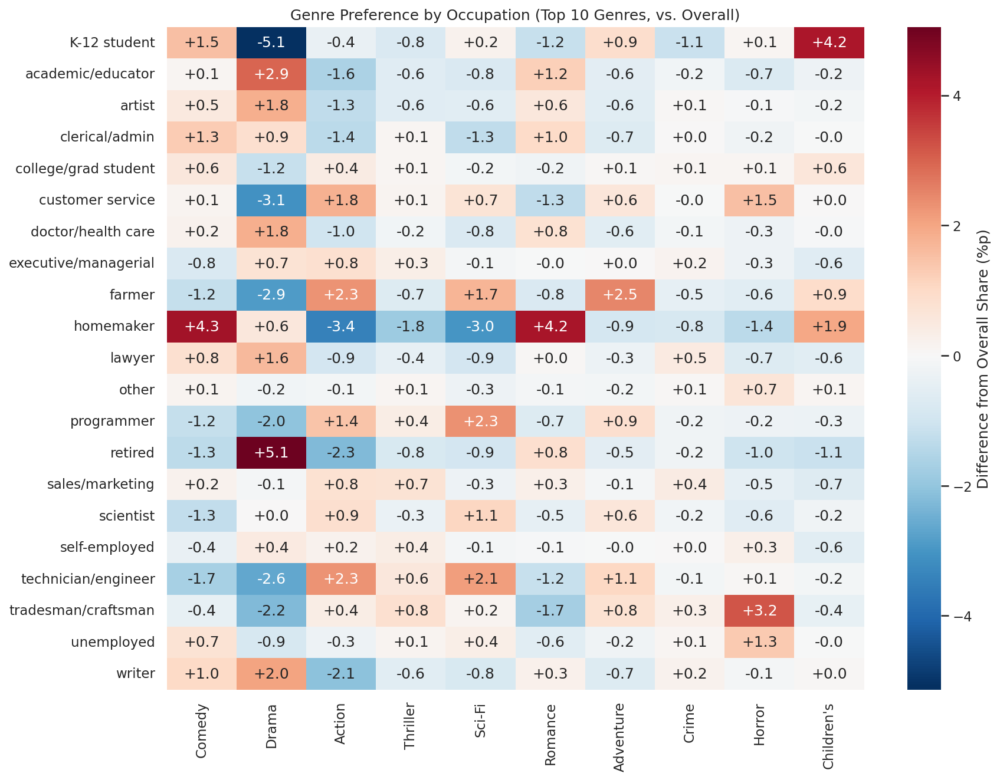
- 직업에 따른 차이는 대부분 ±2%p 이내로 성별·나이대보다 작다. 다만 retired의 Drama(+5.1%p), K-12 student의 Children's(+4.2%p, Drama -5.1%p), homemaker의 Comedy(+4.3%p)·Romance(+4.2%p), programmer·technician의 Sci-Fi(+2%p 이상), tradesman의 Horror(+3.2%p)는 뚜렷하다.

## 7. 결론 및 시사점

- **양 ≠ 질**: 영화 수가 많은 장르(Comedy·Action)와 평점이 높은 장르(Film-Noir·Documentary·War)는 다르며, 둘 사이 상관은 오히려 약한 음(-0.32)이다. 추천 시 "인기 장르"와 "만족도 높은 장르"를 구분해야 한다.
- **성별·나이대는 선호 장르를 뚜렷하게 가른다.** 여성은 Romance·Drama, 남성은 Action·Sci-Fi, 18세 미만은 Children's·Animation, 나이가 많을수록 Drama·War·Romance 비중이 커진다.
- **직업은 보조 변수**: 차이는 대부분 ±2%p 이내지만 은퇴자(Drama), 초중고 학생(Children's), 주부(Comedy·Romance), 프로그래머·엔지니어(Sci-Fi)에서는 뚜렷한 선호가 나타난다.
- 평점 이력이 없는 신규 유저라도 성별·나이대(+직업)만으로 초기 추천 장르를 정하는 **Cold-start 전략**의 근거로 활용할 수 있다.

## 8. 사용 기술

| 분류 | 내용 |
|---|---|
| 데이터 처리 | pandas (`merge`, `explode`, `groupby`, `pivot`, `pivot_table`, `Categorical`), 정규식 연도 추출 |
| 시각화 | seaborn (`barplot`, `lineplot`, `scatterplot`, `countplot`, `histplot`, `heatmap`), matplotlib (`pie`, `subplots`, `bar_label`, `annotate`, `PercentFormatter`) |
| 시각화 설계 | 집단 크기 차이 보정(비율화), 상위 N + Others 묶기, 장르별 고정 색상 팔레트, 전체 평균 대비 차이(발산형 컬러맵), 그래프 자동 저장 |

## 참고

- F. Maxwell Harper and Joseph A. Konstan. 2015. *The MovieLens Datasets: History and Context.* ACM TiiS 5(4).
- https://grouplens.org/datasets/movielens/1m/
